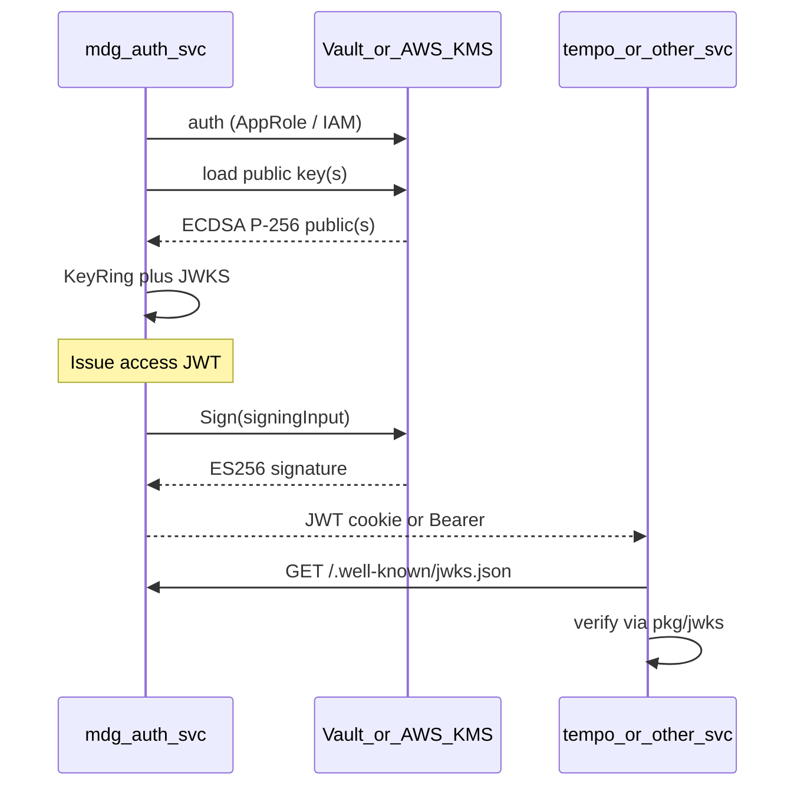
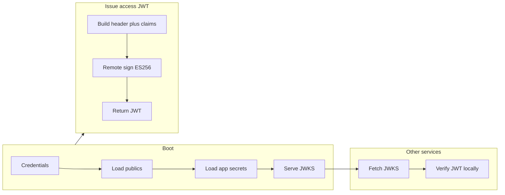
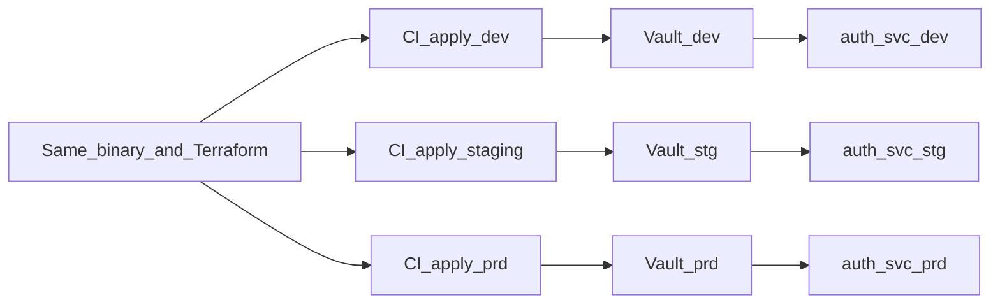

# JWT signing & app secrets (mdg-auth-svc)

Access tokens are **ES256** (ECDSA P-256) JWTs. The private key **never** lives in the app process — signing is delegated to either **HashiCorp Vault Transit** or **AWS KMS**. Other Mitdo services never call Vault or KMS; they verify with publics from `GET /.well-known/jwks.json` (`pkg/jwks`).

Switch backends with config or env:

```yaml
jwt:
  signer: kms   # or vault
```

```bash
export JWT_SIGNER=kms     # default
# export JWT_SIGNER=vault
```

| `jwt.signer` | Sign API | App secrets | JWKS `kid` |
|--------------|----------|-------------|------------|
| `kms` (default) | AWS KMS `Sign` (`ECDSA_SHA_256`) | Secrets Manager JSON (`kms.secrets_id`) and/or env | `kms.kid` (default `kms-1`) |
| `vault` | Vault Transit `transit/sign/jwt-access` | Vault KV `secret/mdg-auth/<APP_ENV>` | Transit version (`v1`, `v2`, …) |

YAML keeps **public** values only (callback URLs, TTLs, ports). OAuth `client_*` and `session_secret` come from the secrets backend (or env overrides).

---

## Shared flow (both backends)





On `jwt.reload_interval_seconds` (default 30), auth-svc re-fetches public keys and updates JWKS / active `kid` without restart.

---

## Vault mode (`jwt.signer=vault`)

### What it uses

| Concern | Path / mechanism |
|---------|------------------|
| Auth | AppRole (`VAULT_ROLE_ID` + `VAULT_SECRET_ID`) or `VAULT_TOKEN` (local only) |
| Sign | Transit key `jwt-access` (ecdsa-p256, **not exportable**) |
| Publics | `GET transit/keys/jwt-access` → versions → `kid` = `v{n}` |
| Secrets | KV v2 `secret/mdg-auth/<APP_ENV>` (API: `secret/data/mdg-auth/<env>`) |

### Local / test

```bash
cp deploy/vault/.app-secrets.env.example deploy/vault/.app-secrets.env
# fill GOOGLE_* / GITHUB_* / SESSION_SECRET

JWT_SIGNER=vault make run-dev   # Docker Vault + bootstrap + auth-svc (:8080)
make deploy-test                # MySQL + Vault + auth image (:5001)
```

Bootstrap (`make vault` / `deploy/vault/bootstrap-dev.sh`) enables Transit + KV, seeds secrets, creates AppRole, writes `deploy/vault/.dev-creds`.

Inspect:

```bash
export VAULT_ADDR=http://127.0.0.1:8200 VAULT_TOKEN=root
vault read transit/keys/jwt-access
vault kv get secret/mdg-auth/dev
```

Rotate Transit: `./deploy/vault/rotate.sh` (or CI workflow) — hot-reload picks up the new version / `kid`.

### Staging / prd (Vault)

Same binary; **separate** Vault (or namespace) and Transit material per env — never copy keys from `dev` → `prd`.

Apply [`deploy/vault/`](../deploy/vault/) Terraform with separate state per env; inject AppRole into the process (not root).



---

## AWS KMS mode (`jwt.signer=kms`)

### What it uses

| Concern | Mechanism |
|---------|-----------|
| Auth | Default AWS credential chain (task/instance **IAM role** preferred) |
| Sign | KMS asymmetric key, `MessageType=DIGEST` + SHA-256 of signing input |
| Publics | `GetPublicKey` → single ECDSA P-256 public → JWKS |
| Secrets | Secrets Manager secret (JSON) via `kms.secrets_id`, and/or env |

### Local / test (LocalStack)

Same OAuth seed file as Vault (`deploy/vault/.app-secrets.env`):

```bash
make run-dev                   # LocalStack + KMS + Secrets Manager + auth-svc (:8080)
make run-test                  # APP_ENV=test / mdg-auth/test
make aws                       # only start/bootstrap LocalStack (optional)
```

| Piece | Value |
|-------|--------|
| Endpoint | `http://127.0.0.1:4566` (`AWS_ENDPOINT_URL` / `kms.endpoint`) |
| Image | `localstack/localstack:4.14.0` (no auth token); `:stable` needs `LOCALSTACK_AUTH_TOKEN` |
| KMS | `alias/mdg-auth-jwt` (ECC_NIST_P256 `SIGN_VERIFY`) |
| Secrets | `mdg-auth/dev`, `mdg-auth/test` |
| Creds | `deploy/aws/.dev-creds` (gitignored) |

See [`deploy/aws/README.md`](../deploy/aws/README.md).

### AWS setup checklist (real account)

1. Create KMS key: **ECC_NIST_P256**, key usage **SIGN_VERIFY**.
2. (Optional) alias, e.g. `alias/mdg-auth-jwt`.
3. Create Secrets Manager secret with JSON:

```json
{
  "google_client_id": "...",
  "google_client_secret": "...",
  "github_client_id": "...",
  "github_client_secret": "...",
  "session_secret": "at-least-32-bytes-of-random"
}
```

4. IAM on the auth-svc role:

   - `kms:Sign`, `kms:GetPublicKey` on the key ARN  
   - `secretsmanager:GetSecretValue` on the secret ARN (if used)

5. Configure:

```yaml
jwt:
  signer: kms

kms:
  region: ap-southeast-1
  key_id: alias/mdg-auth-jwt   # or key ARN / id
  kid: kms-1
  secrets_id: mdg-auth/prd     # name or ARN; omit if using env only
```

```bash
export JWT_SIGNER=kms
export AWS_REGION=ap-southeast-1
export KMS_KEY_ID=alias/mdg-auth-jwt
export KMS_KID=kms-1
export KMS_SECRETS_ID=mdg-auth/prd
```

### Rotation (KMS)

Asymmetric KMS keys are typically rotated by introducing a **new** key (or alias target), bumping `kms.kid`, deploying, then retiring the old key after JWTs expire. Keep prior publics in JWKS only if you extend the code to load multiple key IDs; today one active KMS key / `kid` is loaded.

---

## Config profiles

Merge order (Spring-like): `config.yaml` → `config.<APP_ENV>.yaml` → optional extras from `app.profiles` / `APP_PROFILES`. Overlays list **deltas only** (e.g. `config.prd.yaml` is mostly `cookie.secure: true`).

Placeholders:

```yaml
mysql:
  database: ${MYSQL_DATABASE:mdg_auth}
kms:
  region: ${KMS_REGION:${AWS_REGION:}}
```

`${NAME}` → env or empty · `${NAME:default}` → env or default · nested `${A:${B:x}}` supported.

## Environment reference

| Env | Purpose |
|-----|---------|
| `APP_ENV` | `dev` / `test` / `prd` → primary overlay + default KV path |
| `APP_PROFILES` | optional extra overlays, e.g. `aws` → `config.aws.yaml` |
| `JWT_SIGNER` | `kms` (default) or `vault` |
| `VAULT_ADDR` | Vault API URL |
| `VAULT_ROLE_ID` / `VAULT_SECRET_ID` | AppRole |
| `VAULT_TOKEN` | Dev/test override (avoid in prd) |
| `VAULT_TRANSIT_KEY` | default `jwt-access` |
| `VAULT_SECRETS_PATH` | optional KV API path (default `secret/data/mdg-auth/<APP_ENV>`) |
| `VAULT_NAMESPACE` | HCP / Enterprise namespace (e.g. `admin`) |
| `KMS_KEY_ID` | KMS key id / ARN / alias |
| `KMS_REGION` / `AWS_REGION` | AWS region |
| `KMS_KID` | JWT / JWKS kid |
| `KMS_SECRETS_ID` / `AWS_SECRETS_MANAGER_SECRET_ID` | Secrets Manager id |
| `KMS_ENDPOINT` / `AWS_ENDPOINT_URL` | LocalStack endpoint (omit on real AWS) |
| `SESSION_SECRET`, `GOOGLE_CLIENT_*`, `GITHUB_CLIENT_*` | Optional overrides (win over backends) |
| `GOOGLE_CALLBACK_URL`, `GITHUB_CALLBACK_URL`, `FRONTEND_URL` | Public URL overrides |

---

## Consumers

```go
cl, _ := jwks.NewClient("http://localhost:8080/.well-known/jwks.json")
v := jwks.NewVerifier(cl, "mdg-auth-svc")
```

Issuer and algorithm stay the same regardless of `jwt.signer`; only how the signature is produced and which `kid` appears in the header differ.
